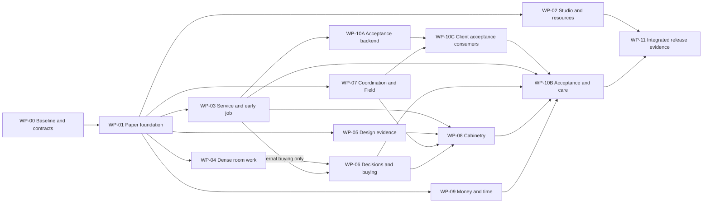

# Delivery sequence and work packages

These are specifications for later execution, not running tasks or a second queue. No development team is launched by this preparation. At kickoff, the integration lead enqueues the commissioned work through `agent_tasks`, linking the applicable WP ID and branch. Queue transitions and evidence stay in the canonical audited system.

## Work packages

| ID | Outcome / accountable stream | Dependencies | Required proof |
|---|---|---|---|
| WP-00 | Current baseline, preservation inventory, token mapping and C1–C7 contracts / integration + domain + quality | None | Real source/runtime matrix; role matrix; schema/RPC reuse decisions; visual reconciliation; local baseline failures named |
| WP-01 | Paper foundation, studio/job frame, index and return contract / foundation | WP-00 identity and visual mapping | One live job slice, desktop/phone, keyboard/focus/Back/reload; existing singleton providers retained |
| WP-02 | Studio, resources and relationship entry points / studio | WP-01, existing read models verified in WP-00 | Actual jobs/inquiries/next acts, Library/People/Measured rooms, command/utility discovery, exact deep links and source return |
| WP-03 | Early job and service configuration / foundation owns A03, build domain owns A04 | WP-01, C1/C2/C3 | Inquiry/direct-job lineage; all four arrangements; per-package responsibility; proposal cannot mutate agreed baseline |
| WP-04 | Dense room work and library placement / selections | WP-01, C1, cache/URL/focus contracts | 36/80 baseline and larger fixtures; specialized lenses, stable IDs, idempotent placement, real save/recovery and preserved existing capabilities |
| WP-05 | Room evidence and issue history / design evidence | WP-01, C1/C7; integrates WP-04 | Scans/concepts/drawings/boards, source/version/privacy, fixed issues and recipient holdings; line/site links return correctly |
| WP-06 | Item decisions, purchasing, receiving and order books / commerce; C5 owned by build domain | WP-04, C3/C4/C7; WP-03/C2/C5 gate external-buying mutations only | Version-specific partial decisions; authority/funding distinct; exact maker grouping, acknowledgement difference, receipt/claim and accounting boundaries |
| WP-07 | Contextual notes, people and Field returns / coordination | WP-01, C3/C7; integrates WP-02/04/05 | Same subject across views; audience-safe draft/send history; appointments/work copies; site evidence returns to actual affected work |
| WP-08 | Custom cabinetry with the building team / build domain + UI | WP-03/05/07, C4/C5; WP-06 boundary integration | Full CP-01-equivalent journey with GC purchase/no studio PO; maker and designer-detail routes; hold/change/issue/instruction/receipt evidence |
| WP-09 | Service fees, time and accounts / commerce | WP-01, existing billing contracts; integrates WP-03/02 | One timer; dated rates and pending-rate state; claim/void/release; correct issued/received/due; studio/job agreement |
| WP-10A | Acceptance record, RPC and compatible projections / closeout domain | WP-03, C4/C6/C7, recorded P06/P07 policy | Auth/version/idempotency/audit and old-reader contract; server activation/grant plan; backend ready for client consumers |
| WP-10C | Client acceptance request/response and offline evidence / client-consumer owner | WP-03/07/10A, reviewed C4/C6/C7, P06/P07 policy | V22 designer request, authenticated client-portal/iOS response, exact scope, signer/return paths, permitted paper intake, old-reader safety |
| WP-10B | Integrated designer acceptance, completion and care / closeout domain + UI | WP-03/06/08/09/10A/10C, C4/C6/C7 | Joint signatories, return/supersession, scoped obligations, external work, frozen evidence and care return; no UI bypass of close_project |
| WP-11 | Integrated quality, migration rehearsal and release candidate / quality + integration | Acceptance evidence for WP-01–09 and WP-10A/10B/10C | Complete live-data journeys, preserved capability inventory, roles/failures/concurrency, browser/a11y/performance, rollout and rollback evidence |

Quality work runs in every wave; WP-11 collects the integrated result rather than discovering basic failures at the end. Contracts may be settled incrementally: an unresolved C5 external-fabrication question does not block existing library or paper work, but it does block dependent cabinet state mutations.

## Team dispatch briefs

- [00 — Baseline and contracts](briefs/00-baseline-and-contracts.md)
- [01 — Foundation and job composition](briefs/01-foundation-and-job.md)
- [02 — Studio and resources](briefs/02-studio-and-resources.md)
- [03 — Selections and design evidence](briefs/03-selections-and-design.md)
- [04 — Commerce and coordination](briefs/04-commerce-and-coordination.md)
- [05 — Build team and acceptance](briefs/05-build-and-acceptance.md)
- [06 — Quality and integration](briefs/06-quality-and-integration.md)
- [07 — Client acceptance consumers](briefs/07-client-acceptance-consumers.md)

A stream can be split into smaller tasks only after explicit path ownership is assigned. The listed dependencies describe integration readiness, not a requirement that every stream work serially or that one giant PR implement a work package.

## Acceptance ownership

The WP owner is accountable for its acceptance evidence, with quality providing independent proof. For shared journeys: foundation owns A01/A02/A03; build domain owns A04 and A16–A18; selections owns A05–A07; design evidence owns A08/A09/A15; commerce owns A10–A12/A19; studio owns A13/A24; coordination owns A14. Closeout owns A20–A23; the client-consumer owner must jointly sign off A20–A22/X08 before WP-10B passes. WP-10A lands the reviewed backend/projections first; WP-10C then proves actual client responses; WP-10B integrates designer completion and care. “WP-10” denotes this three-part outcome, not a circular dependency. Supporting teams supply evidence without creating a second owner for the same state transition.

## First vertical slice

After WP-00, prove: **live studio next act → existing job → living-room evidence → exact FF&E line → save → close to the same room → return to studio**. Include one failed save and keyboard-only return. This establishes the new design without inventing a new business model. Use the real identity resolver, caches, overlays and existing permissions.

Then add complete journeys, not isolated styled pages: inquiry-to-service; library-to-selection; decision-to-receipt; cabinet-question-to-exact-issue; hours-to-invoice; service-acceptance-to-care.

## Shared-file ownership

The integration lead owns changes to `doc/[id]/page.tsx`, `(document)/layout.tsx`, `lib/document/registry.tsx`, shared query/identity contracts and final route wiring. Foundation owns the scoped token mapping. Domain owners own mutations and migrations. Feature teams deliver bounded section/reading components and integration patches rather than independently rewriting the orchestrator. Conflicting ownership is resolved before dispatch, not during merge.

## Release exit

Every acceptance ID has evidence or an explicitly accepted, bounded deferral; the founding team has reviewed the integrated desktop and phone journey; business/security invariants have no unresolved blocking findings; the runtime baseline and newly introduced regressions are distinguished; rollout/rollback has been rehearsed. A green static screenshot or build alone does not satisfy exit.
